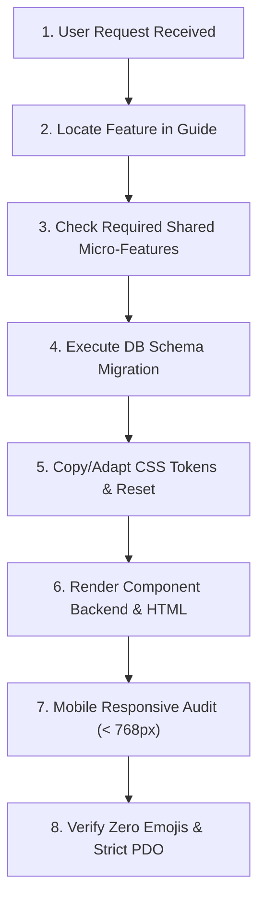

# MASTER AGENT IMPLEMENTATION BLUEPRINT & VISUAL CONTEXT
> **Target Audience:** Autonomous AI Coding Agents & Pair-Programmers  
> **Source Base:** The Chitrakoot Update (Luxury Editorial CMS & News Portal)  
> **Scope:** Reusable feature-by-feature implementation guide with visual architecture, server-side functions, CSS design tokens, and mobile-first rules.

---

## 1. AGENT OPERATIONAL PROTOCOL (CRITICAL DIRECTIVES)

When an AI agent is instructed to use this guide to develop another website or port features from this CMS, the agent **MUST STRICTLY OBEY** the following execution protocols:

### Directive A: "One Feature at a Time" (No Blind Scaffolding)
- **NEVER** attempt to generate the entire website or multiple features all at once.
- **ONLY build the specific feature requested by the user** in their current prompt.
- If the user asks for "Add the navigation bar", build *only* the navigation bar and its dependent CSS/tokens, nothing else.
- Follow this strict 5-stage loop for each feature:
  1. **Identify Dependencies:** Check the database schema and shared micro-features required.
  2. **Database & Backend:** Write/migrate table schema and PDO functions.
  3. **CSS & Design Tokens:** Implement tokens and component CSS with mobile-first media queries.
  4. **Frontend Markup:** Render semantic HTML using SVG icons only.
  5. **Mobile Verification:** Test `< 768px` viewport layout, touch targets ($\ge 44\text{px}$), and body scroll locks.

### Directive B: The Zero-Emoji Law
- **NEVER** use unicode emojis (`📰`, `❤️`, `🔥`, `📷`, `✨`, etc.) anywhere in HTML, CSS, JavaScript, PHP, or database seeds.
- **Always** use inline SVG icons (`<svg viewBox="0 0 24 24" ...>`) or standard HTML typographic entities (`&bull;`, `&rarr;`, `&larr;`, `&times;`).

### Directive C: Mobile-First Responsive Standard
- All layout grids must default to a single-column stack on screens `< 768px`.
- Mobile navigation overlays/drawers must strictly occupy `100vw` / `100dvh` with body scroll locking (`overflow: hidden` on `body.drawer-open`).
- Horizontal navigation or sub-tabs on mobile must use horizontal scroll snapping (`overflow-x: auto; flex: 0 0 auto; scrollbar-width: none; border-radius: 9999px;`) instead of cramming buttons into desktop multi-column rows.
- Minimum interactive touch target size: **44px $\times$ 44px**.

### Directive D: 10-Item Data Pagination & Lazy Loading
- All initial public and admin entity listings (posts, comments, bookings, media, supporters) **must cap initial results to 10 items**.
- Provide a clean "Load More" action button or lazy-scroll observer (`admin-lazy-scroll.js`) to prevent memory spikes.

### Directive E: Strict Security & Database Sanitization
- Strictly use **PDO Prepared Statements** with parameter binding (`$stmt->prepare()` and `$stmt->execute([$param])`).
- Strictly enforce `password_verify($password, $user['password_hash'])` with zero backdoor credentials.
- Sanitize inputs on receipt and escape with `htmlspecialchars($var, ENT_QUOTES, 'UTF-8')` on output.

---

## 2. PROJECT ARCHITECTURE & VISUAL TAXONOMY

### 2.1 Visual Design Language
- **Style Archetype:** High-end, luxury editorial journalism inspired by *Apple Newsroom*, *The New York Times*, and *The Atlantic*.
- **Palette Foundation:** Warm antique paper base (`#f9f8f6`), deep editorial ink (`#17211c`), royal crimson red accent (`#8f1719`), sacred saffron highlight (`#f4a900`), and forest green badges (`#086c60`).
- **Surface Elevation:** Subtle translucent frosted glass (`backdrop-filter: blur(20px); -webkit-backdrop-filter: blur(20px); background: rgba(255,255,255,0.92);`).
- **Button Geography:** Pure pill-shaped buttons (`border-radius: 9999px`) with balanced typography and subtle hover elevation. Bulky rectangular buttons are strictly banned.

### 2.2 System Directory Map
```
/
├── includes/
│   ├── config.php          # DB PDO connection, sessions, SITE_URL, security headers
│   ├── functions.php       # Shared micro-features, WebP engine, SEO, helpers, KV settings
│   ├── header.php          # Frosted-glass masthead, dynamic dropdowns, mobile drawer, loader
│   ├── footer.php          # Luxury footer, newsletter CTA, mobile bottom floating dock
│   ├── widgets.php         # 20 modular news & utility widgets + shortcode engine
│   └── smtp_mailer.php     # Templated transactional HTML email dispatcher
├── admin/
│   ├── auth_check.php      # RBAC session check & redirector
│   ├── post-editor.php     # Newsroom draft autosave editor
│   ├── posts-list.php      # 10-entity paginated posts manager
│   ├── media-gallery.php   # Reusable WebP media manager
│   ├── media-picker-component.php # Universal modal media selector
│   ├── homepage-settings.php # Dynamic KV settings interface
│   └── ...
├── assets/
│   ├── css/
│   │   ├── style.css       # Master public stylesheet & CSS design tokens
│   │   └── admin.css       # CMS backoffice luxury stylesheet
│   └── js/
│       ├── main.js         # Public interactions, drawer toggles, lightboxes, AJAX
│       └── admin-lazy-scroll.js # Infinite scroll & pagination helper
├── database/
│   ├── schema.sql          # Primary MySQL / MariaDB tables schema
│   └── update_db_v2.php    # Secondary migration (menus, pages, tags)
└── [Public Endpoints]
    ├── index.php           # Dynamic homepage broadsheet
    ├── article.php         # Single article, lightbox zoom, threaded comments, likes
    ├── news.php            # Paginated news grid & category filtering
    ├── stories.php         # Fullscreen mobile web-story / reels viewer
    ├── tourism.php         # Tourism destinations & booking checkout
    ├── donations.php       # Reader membership & donation giving engine
    ├── supporters.php      # Wall of fame & canvas supporter card
    └── gallery.php         # Editorial photo archive & commercial licensing
```

---

## 3. CORE REUSABLE MICRO-FEATURES (THE FOUNDATION)
> *Note for AI Agents: When building high-level features later in this document, reference these foundation micro-features instead of re-implementing them redundantly.*

### Micro-Feature A: Dynamic Key-Value Settings Engine (`homepage_settings` & `seo_settings`)
- **File:** [includes/functions.php](file:///f:/Projects/The%20chitrakoot%20update/includes/functions.php)
- **Database Table:**
  ```sql
  CREATE TABLE IF NOT EXISTS homepage_settings (
    setting_key VARCHAR(100) PRIMARY KEY,
    setting_value TEXT DEFAULT NULL
  ) ENGINE=InnoDB DEFAULT CHARSET=utf8mb4 COLLATE=utf8mb4_unicode_ci;
  ```
- **Backend Function:**
  ```php
  function get_home_setting($key, $default = '') {
      global $pdo;
      static $cache = null;
      if ($cache === null && $pdo) {
          $stmt = $pdo->query("SELECT setting_key, setting_value FROM homepage_settings");
          $cache = $stmt->fetchAll(PDO::FETCH_KEY_PAIR) ?: [];
      }
      return $cache[$key] ?? $default;
  }

  function set_home_setting($key, $value) {
      global $pdo;
      if (!$pdo) return false;
      $stmt = $pdo->prepare("INSERT INTO homepage_settings (setting_key, setting_value) 
                             VALUES (?, ?) ON DUPLICATE KEY UPDATE setting_value = VALUES(setting_value)");
      return $stmt->execute([$key, $value]);
  }
  ```

### Micro-Feature B: Server-Side WebP Conversion Engine
- **File:** [includes/functions.php](file:///f:/Projects/The%20chitrakoot update/includes/functions.php#L790-L830)
- **Purpose:** Automatically optimize every uploaded JPEG/PNG image to WebP format with an 82% quality compression factor, preserving natural aspect ratio without forced crops.
- **Backend Function:**
  ```php
  function convert_to_webp($sourcePath, $quality = 82) {
      if (!file_exists($sourcePath)) return false;
      $info = getimagesize($sourcePath);
      if (!$info) return false;
      $mime = $info['mime'];

      switch ($mime) {
          case 'image/jpeg': $img = imagecreatefromjpeg($sourcePath); break;
          case 'image/png':
              $img = imagecreatefrompng($sourcePath);
              imagepalettetotruecolor($img);
              imagealphablending($img, true);
              imagesavealpha($img, true);
              break;
          case 'image/webp': return $sourcePath;
          default: return false;
      }

      $destination = preg_replace('/\.(jpe?g|png)$/i', '.webp', $sourcePath);
      if ($destination === $sourcePath) $destination .= '.webp';
      imagewebp($img, $destination, $quality);
      imagedestroy($img);
      if ($destination !== $sourcePath && file_exists($destination)) {
          @unlink($sourcePath); // Remove original uncompressed file
      }
      return $destination;
  }
  ```

### Micro-Feature C: Reusable Modal Media Picker Component
- **Files:** [admin/media-picker-component.php](file:///f:/Projects/The%20chitrakoot%20update/admin/media-picker-component.php), [admin/ajax-image-upload.php](file:///f:/Projects/The%20chitrakoot%20update/admin/ajax-image-upload.php), [admin/ajax-media-list.php](file:///f:/Projects/The%20chitrakoot%20update/admin/ajax-media-list.php)
- **Purpose:** Centralized modal allowing any admin form or post editor to upload images via drag-and-drop or select an existing WebP asset from the server media library.
- **Usage Pattern in Admin Forms:**
  ```html
  <div class="media-input-group">
      <input type="hidden" name="featured_image" id="featuredImageInput" value="...">
      
      <button type="button" class="btn btn-secondary open-media-picker-btn" data-target-input="#featuredImageInput" data-target-preview="#featuredImagePreview">
          Select / Upload Image
      </button>
  </div>
  ```

### Micro-Feature D: Automated SEO & JSON-LD Structured Data Generator
- **File:** [includes/functions.php](file:///f:/Projects/The%20chitrakoot%20update/includes/functions.php#L322-L400)
- **Backend Function:**
  ```php
  function render_seo_tags($pageTitle = '', $pageDesc = '', $pageImage = '', $pageUrl = '', $schemaType = 'NewsArticle') {
      $siteTitle = get_setting('site_name', 'The Chitrakoot Update');
      $fullTitle = $pageTitle ? htmlspecialchars($pageTitle . ' - ' . $siteTitle) : htmlspecialchars($siteTitle);
      $desc = htmlspecialchars($pageDesc ?: get_setting('site_description', 'Independent Journal of Chitrakoot'));
      $img = htmlspecialchars($pageImage ?: SITE_URL . 'assets/uploads/default-og.webp');
      $url = htmlspecialchars($pageUrl ?: SITE_URL);

      return <<<HTML
      <title>{$fullTitle}</title>
      <meta name="description" content="{$desc}">
      <meta property="og:type" content="article">
      <meta property="og:title" content="{$fullTitle}">
      <meta property="og:description" content="{$desc}">
      <meta property="og:image" content="{$img}">
      <meta property="og:url" content="{$url}">
      <meta name="twitter:card" content="summary_large_image">
      <script type="application/ld+json">
      {
        "@context": "https://schema.org",
        "@type": "{$schemaType}",
        "headline": "{$fullTitle}",
        "image": ["{$img}"],
        "publisher": { "@type": "Organization", "name": "{$siteTitle}" }
      }
      </script>
  HTML;
  }
  ```

---

## 4. FEATURE-BY-FEATURE IMPLEMENTATION CATALOG

```
INDEX OF MODULAR FEATURES:
[Feature 01] Design System Tokens & Base CSS Reset
[Feature 02] Luxury Frosted-Glass Masthead & 100vh Mobile Drawer (Navigation)
[Feature 03] Global Editorial Footer & Mobile Bottom Floating Dock
[Feature 04] Cinematic Editorial Homepage & Broadside Hero Layout
[Feature 05] Single Article Engine (Drop-cap, Lightbox Zoom, Threaded Comments)
[Feature 06] Newsroom Post CMS & 15-Second Draft Autosave Engine
[Feature 07] 20 Modular Interactive Widgets Engine & Shortcode Parser
[Feature 08] Mobile-First Fullscreen Visual Stories & Reels Viewer
[Feature 09] Tourism Directory, Destination Guides & Tour Booking Flow
[Feature 10] Reader Supporter System, Dynamic Canvas ID Cards & Receipts
[Feature 11] Stock Photo Gallery, EXIF Metadata & License Purchase Flow
```

---

### [Feature 01] Design System Tokens & Base CSS Reset
*This provides the foundational visual styling that all subsequent components inherit.*

#### 1. File Locations
- **CSS File:** [assets/css/style.css](file:///f:/Projects/The%20chitrakoot%20update/assets/css/style.css#L1-L50)

#### 2. Code Implementation (CSS)
```css
/* ==========================================================================
   DESIGN TOKENS & BASE RESET
   ========================================================================== */
:root {
    --ink: #17211c;
    --muted: #737b73;
    --paper: #f9f8f6;
    --white: #ffffff;
    --saffron: #f4a900;
    --red: #8f1719;
    --red-hover: #6d1012;
    --green: #086c60;
    --line: rgba(23, 33, 28, 0.12);
    --serif: "Playfair Display", Georgia, serif;
    --hindi: "Noto Sans Devanagari", sans-serif;
    --sans: "DM Sans", -apple-system, BlinkMacSystemFont, "Segoe UI", Roboto, sans-serif;
}

/* Dark Theme Tokens */
body.dark-theme {
    --ink: #f6f3eb;
    --muted: #a3aaa3;
    --paper: #111713;
    --white: #1b241e;
    --line: rgba(255, 255, 255, 0.14);
}

* { box-sizing: border-box; }
html { 
    scroll-behavior: smooth; 
    scroll-padding-top: 80px; 
    overflow-x: hidden; 
    width: 100%; 
}
body {
    margin: 0;
    width: 100%;
    max-width: 100vw;
    overflow-x: hidden;
    background: var(--paper);
    color: var(--ink);
    font-family: var(--sans);
    -webkit-font-smoothing: antialiased;
    transition: background-color 0.3s ease, color 0.3s ease;
}

/* Typography & Layout Utilities */
a { color: inherit; text-decoration: none; }
button { font: inherit; cursor: pointer; }
img { display: block; max-width: 100%; height: auto; }
.hindi { font-family: var(--hindi); }
.eyebrow { 
    font-size: 11px; 
    font-weight: 700; 
    letter-spacing: .18em; 
    text-transform: uppercase; 
    color: var(--green); 
}
.wrap { 
    width: min(1240px, calc(100% - 48px)); 
    margin: auto; 
}

/* Sleek Pill Button Archetype */
.btn {
    display: inline-flex;
    align-items: center;
    justify-content: center;
    gap: 8px;
    padding: 10px 24px;
    border-radius: 9999px;
    font-size: 14px;
    font-weight: 600;
    border: 1px solid transparent;
    transition: all 0.25s cubic-bezier(0.16, 1, 0.3, 1);
    min-height: 44px; /* Touch target safety */
}
.btn-primary {
    background: var(--red);
    color: var(--white);
}
.btn-primary:hover {
    background: var(--red-hover);
    transform: translateY(-1px);
    box-shadow: 0 4px 14px rgba(143, 23, 25, 0.35);
}
.btn-ghost {
    background: transparent;
    border-color: var(--line);
    color: var(--ink);
}
.btn-ghost:hover {
    border-color: var(--ink);
}
```

---

### [Feature 02] Luxury Frosted-Glass Masthead & 100vh Mobile Drawer (Navigation)
*Adaptive navbar that remains transparent over hero sections on the homepage and morphs into frosted glass on scroll or inner pages, paired with a full-viewport mobile drawer.*

#### 1. File Locations
- **Backend/Template:** [includes/header.php](file:///f:/Projects/The%20chitrakoot%20update/includes/header.php#L70-L125)
- **CSS Styling:** [assets/css/style.css](file:///f:/Projects/The%20chitrakoot%20update/assets/css/style.css#L70-L140)
- **Interactivity:** [assets/js/main.js](file:///f:/Projects/The%20chitrakoot%20update/assets/js/main.js)

#### 2. Database Schema (Hierarchical Menu)
```sql
CREATE TABLE IF NOT EXISTS nav_menu_items (
    id INT AUTO_INCREMENT PRIMARY KEY,
    title VARCHAR(100) NOT NULL,
    url VARCHAR(255) NOT NULL,
    parent_id INT DEFAULT NULL,
    menu_order INT DEFAULT 0,
    target VARCHAR(20) DEFAULT '_self',
    created_at TIMESTAMP DEFAULT CURRENT_TIMESTAMP,
    FOREIGN KEY (parent_id) REFERENCES nav_menu_items(id) ON DELETE CASCADE
) ENGINE=InnoDB DEFAULT CHARSET=utf8mb4;
```

#### 3. Frontend Markup Structure (`includes/header.php`)
```html
<header class="masthead" id="masthead">
    <div class="wrap nav">
        <a class="brand" href="/">
            
            <div>
                <div class="brand-name">THE CHITRAKOOT UPDATE</div>
                <div class="brand-tag">Faith &bull; Culture &bull; Local News</div>
            </div>
        </a>

        <!-- Desktop Navigation Items -->
        <nav class="navlinks" id="navlinks">
            <a href="/">Home</a>
            <div class="nav-dropdown">
                <a href="/news.php" class="dropdown-trigger">
                    News <svg width="10" height="6" viewBox="0 0 10 6" fill="currentColor"><path d="M0 0l5 6 5-6z"/></svg>
                </a>
                <div class="dropdown-menu">
                    <a href="/category.php?slug=current-affairs">Current Affairs</a>
                    <a href="/category.php?slug=culture">Culture</a>
                </div>
            </div>
            <a href="/tourism.php">Tourism</a>
            <a href="/donations.php">Support Us</a>
        </nav>

        <!-- Right Action Hub -->
        <div class="nav-actions">
            <a href="/supporters.php" class="supporters-pill">Wall of Fame</a>
            <button class="menu-toggle" id="menuToggle" aria-label="Open Navigation">
                <svg width="22" height="22" viewBox="0 0 24 24" fill="none" stroke="currentColor" stroke-width="2">
                    <line x1="3" y1="12" x2="21" y2="12"></line>
                    <line x1="3" y1="6" x2="21" y2="6"></line>
                    <line x1="3" y1="18" x2="21" y2="18"></line>
                </svg>
            </button>
        </div>
    </div>
</header>

<!-- Full-Screen 100vw/100dvh Mobile Drawer -->
<div class="mobile-drawer" id="mobileDrawer">
    <div class="drawer-header">
        <div class="brand">
            
            <span class="brand-name">The Chitrakoot Update</span>
        </div>
        <button class="drawer-close" id="drawerClose" aria-label="Close Navigation">&times;</button>
    </div>
    <div class="drawer-body">
        <a href="/" class="drawer-link">Home</a>
        <a href="/news.php" class="drawer-link">News Desk</a>
        <a href="/tourism.php" class="drawer-link">Tourism & Pilgrimage</a>
        <a href="/donations.php" class="drawer-link">Support Us</a>
        <div class="drawer-auth-stack">
            <a href="/login.php" class="btn btn-primary" style="width: 100%;">Reader Login / Register</a>
        </div>
    </div>
</div>
```

#### 4. Component CSS & Mobile Media Queries
```css
/* Masthead Container */
.masthead {
    position: fixed;
    top: 0; left: 0; right: 0;
    width: 100%;
    z-index: 1000;
    transition: all 0.35s cubic-bezier(0.16, 1, 0.3, 1);
}
body:not(.is-home) .masthead,
.masthead.scrolled {
    background: rgba(255, 255, 255, 0.94);
    -webkit-backdrop-filter: saturate(180%) blur(20px);
    backdrop-filter: saturate(180%) blur(20px);
    border-bottom: 1px solid var(--line);
    box-shadow: 0 4px 20px rgba(0, 0, 0, 0.04);
}
body.dark-theme .masthead.scrolled {
    background: rgba(17, 23, 19, 0.94);
}
.nav {
    display: flex;
    justify-content: space-between;
    align-items: center;
    padding: 14px 0;
}
.brand {
    display: flex;
    align-items: center;
    gap: 12px;
}
.brand-name {
    font-family: var(--serif);
    font-size: 18px;
    font-weight: 700;
    letter-spacing: 0.04em;
    color: var(--ink);
}
.brand-tag {
    font-size: 11px;
    color: var(--muted);
    letter-spacing: 0.06em;
}
.navlinks {
    display: flex;
    align-items: center;
    gap: 24px;
    font-size: 14px;
    font-weight: 600;
}
.navlinks a:hover { color: var(--red); }

/* Dropdown Menu */
.nav-dropdown { position: relative; }
.dropdown-menu {
    position: absolute;
    top: 100%; left: 0;
    background: var(--white);
    border: 1px solid var(--line);
    border-radius: 12px;
    padding: 8px 0;
    min-width: 180px;
    box-shadow: 0 10px 30px rgba(0,0,0,0.08);
    opacity: 0; visibility: hidden;
    transform: translateY(10px);
    transition: all 0.25s ease;
}
.nav-dropdown:hover .dropdown-menu {
    opacity: 1; visibility: visible;
    transform: translateY(0);
}
.dropdown-menu a {
    display: block;
    padding: 8px 16px;
    color: var(--ink);
}

/* Mobile Drawer (100% Viewport Coverage) */
.mobile-drawer {
    position: fixed;
    inset: 0;
    width: 100vw;
    height: 100vh;
    height: 100dvh;
    background: var(--white);
    z-index: 99999;
    opacity: 0;
    visibility: hidden;
    transform: translateY(-100%);
    transition: all 0.35s cubic-bezier(0.16, 1, 0.3, 1);
    display: flex;
    flex-direction: column;
}
.mobile-drawer.open {
    opacity: 1;
    visibility: visible;
    transform: translateY(0);
}
.drawer-header {
    padding: 16px 24px;
    border-bottom: 1px solid var(--line);
    display: flex;
    justify-content: space-between;
    align-items: center;
}
.drawer-close {
    background: var(--paper);
    border: 0;
    width: 44px; height: 44px;
    border-radius: 50%;
    font-size: 26px;
    display: grid;
    place-items: center;
}
.drawer-body {
    padding: 24px;
    overflow-y: auto;
    display: flex;
    flex-direction: column;
    gap: 16px;
}
.drawer-link {
    font-size: 18px;
    font-weight: 600;
    padding: 8px 0;
    border-bottom: 1px solid var(--line);
}

/* Responsive Media Queries */
@media (max-width: 992px) {
    .navlinks { display: none; }
    .menu-toggle {
        display: grid;
        place-items: center;
        width: 44px; height: 44px;
        background: none; border: 0;
        color: var(--ink);
    }
}
```

#### 5. JavaScript Behavior (`assets/js/main.js`)
```javascript
// Mobile Drawer & Body Scroll Lock
const menuToggle = document.getElementById('menuToggle');
const drawerClose = document.getElementById('drawerClose');
const mobileDrawer = document.getElementById('mobileDrawer');

function toggleDrawer(isOpen) {
    mobileDrawer.classList.toggle('open', isOpen);
    document.body.style.overflow = isOpen ? 'hidden' : '';
    document.body.classList.toggle('drawer-open', isOpen);
}
if (menuToggle) menuToggle.addEventListener('click', () => toggleDrawer(true));
if (drawerClose) drawerClose.addEventListener('click', () => toggleDrawer(false));

// Masthead Frosted Scroll Observer
window.addEventListener('scroll', () => {
    const masthead = document.getElementById('masthead');
    if (masthead) {
        masthead.classList.toggle('scrolled', window.scrollY > 30);
    }
}, { passive: true });
```

---

### [Feature 03] Global Editorial Footer & Mobile Bottom Floating Dock
*Multi-column luxury sitemap with newsletter subscription bar, plus a floating bottom navigation dock for thumb-reachable mobile navigation.*

#### 1. File Locations
- **Backend/Template:** [includes/footer.php](file:///f:/Projects/The%20chitrakoot%20update/includes/footer.php)
- **CSS Styling:** [assets/css/style.css](file:///f:/Projects/The%20chitrakoot%20update/assets/css/style.css#L2220-L2300)

#### 2. Frontend Markup (`includes/footer.php`)
```html
<!-- Editorial Footer -->
<footer class="footer">
    <div class="wrap">
        <div class="footer-grid">
            <div>
                <div class="footer-brand">
                    
                    <strong>THE CHITRAKOOT UPDATE</strong>
                </div>
                <p>Premier independent news and cultural journal of Chitrakoot and Kamadgiri.</p>
            </div>
            <div>
                <h4>Categories</h4>
                <div class="footer-links">
                    <a href="/category.php?slug=current-affairs">Current Affairs</a>
                    <a href="/category.php?slug=faith-culture">Faith & Culture</a>
                    <a href="/category.php?slug=tourism">Tourism & Heritage</a>
                </div>
            </div>
            <div>
                <h4>Important Links</h4>
                <div class="footer-links">
                    <a href="/privacy-policy.php">Privacy Policy</a>
                    <a href="/terms.php">Terms of Service</a>
                    <a href="/sitemap.xml">XML Sitemap</a>
                </div>
            </div>
        </div>
        <div class="footer-bottom">
            <span>&copy; <?php echo date('Y'); ?> The Chitrakoot Update. All rights reserved.</span>
        </div>
    </div>
</footer>

<!-- Mobile Floating Bottom Dock -->
<div class="bottom-nav">
    <a href="/" class="active">
        <svg width="20" height="20" fill="none" stroke="currentColor" stroke-width="2" viewBox="0 0 24 24"><path d="M3 9l9-7 9 7v11a2 2 0 01-2 2H5a2 2 0 01-2-2z"></path></svg>
        <span>Home</span>
    </a>
    <a href="/news.php">
        <svg width="20" height="20" fill="none" stroke="currentColor" stroke-width="2" viewBox="0 0 24 24"><path d="M19 20H5a2 2 0 01-2-2V6a2 2 0 012-2h10a2 2 0 012 2v1m2 13a2 2 0 01-2-2V7m2 13a2 2 0 002-2V9a2 2 0 00-2-2h-2m-4-3H9M7 16h6M7 8h6v4H7V8z"></path></svg>
        <span>News</span>
    </a>
    <a href="/stories.php">
        <svg width="20" height="20" fill="none" stroke="currentColor" stroke-width="2" viewBox="0 0 24 24"><rect x="2" y="2" width="20" height="20" rx="2.18" ry="2.18"></rect><line x1="7" y1="2" x2="7" y2="22"></line><line x1="17" y1="2" x2="17" y2="22"></line><line x1="2" y1="12" x2="22" y2="12"></line></svg>
        <span>Stories</span>
    </a>
    <a href="/profile.php">
        <svg width="20" height="20" fill="none" stroke="currentColor" stroke-width="2" viewBox="0 0 24 24"><path d="M20 21v-2a4 4 0 0 0-4-4H8a4 4 0 0 0-4 4v2"></path><circle cx="12" cy="7" r="4"></circle></svg>
        <span>Profile</span>
    </a>
</div>
```

#### 3. Component CSS & Mobile Media Queries
```css
.footer {
    background: #101812;
    color: #e9e4d8;
    padding: 64px 0 32px;
    border-top: 1px solid rgba(255,255,255,0.08);
}
.footer-grid {
    display: grid;
    grid-template-columns: 2fr 1fr 1fr;
    gap: 48px;
    margin-bottom: 40px;
}
.footer-brand {
    display: flex;
    align-items: center;
    gap: 12px;
    font-family: var(--serif);
    font-size: 18px;
    margin-bottom: 16px;
}
.footer-links {
    display: flex;
    flex-direction: column;
    gap: 10px;
    font-size: 13px;
    color: #a3aaa3;
}
.footer-links a:hover { color: var(--saffron); }

/* Mobile Floating Bottom Dock */
.bottom-nav {
    display: none;
}

@media (max-width: 768px) {
    .footer-grid {
        grid-template-columns: 1fr;
        gap: 32px;
    }
    body {
        padding-bottom: 84px; /* Space for bottom dock */
    }
    .bottom-nav {
        display: flex;
        position: fixed;
        bottom: 16px;
        left: 50%;
        transform: translateX(-50%);
        width: calc(100% - 32px);
        max-width: 440px;
        background: rgba(16, 24, 18, 0.94);
        -webkit-backdrop-filter: blur(20px);
        backdrop-filter: blur(20px);
        border: 1px solid rgba(255,255,255,0.12);
        border-radius: 9999px;
        padding: 6px 12px;
        justify-content: space-around;
        align-items: center;
        z-index: 9990;
        box-shadow: 0 10px 30px rgba(0,0,0,0.3);
    }
    .bottom-nav a {
        display: flex;
        flex-direction: column;
        align-items: center;
        gap: 3px;
        color: rgba(255,255,255,0.7);
        font-size: 10px;
        font-weight: 600;
        min-width: 44px;
        min-height: 44px;
        justify-content: center;
    }
    .bottom-nav a.active {
        color: #ffc443;
    }
    /* Auto-hide bottom dock when mobile drawer is open */
    body.drawer-open .bottom-nav {
        display: none !important;
    }
}
```

---

### [Feature 04] Cinematic Editorial Homepage & Broadside Hero Layout
*Classic 3-column broadsheet with high-impact hero lead story, live ticker, and category card decks.*

#### 1. File Locations
- **Backend/Template:** [index.php](file:///f:/Projects/The%20chitrakoot%20update/index.php)
- **Settings KV Hook:** Uses [Micro-Feature A](file:///f:/Projects/The%20chitrakoot%20update/includes/functions.php) (`homepage_settings`)
- **CSS Styling:** [assets/css/style.css](file:///f:/Projects/The%20chitrakoot%20update/assets/css/style.css)

#### 2. Backend Data Fetching Query (`index.php`)
```php
// Fetch Hero Post (is_hero = 1)
$heroStmt = $pdo->query("SELECT p.*, c.name_en as cat_name, u.name as author_name 
                         FROM posts p 
                         JOIN categories c ON p.category_id = c.id 
                         JOIN users u ON p.author_id = u.id 
                         WHERE p.status = 'published' AND p.is_hero = 1 
                         ORDER BY p.id DESC LIMIT 1");
$heroPost = $heroStmt->fetch();

// Fetch 4 Broadsheet Main Feed Posts
$feedStmt = $pdo->query("SELECT p.*, c.name_en as cat_name 
                         FROM posts p 
                         JOIN categories c ON p.category_id = c.id 
                         WHERE p.status = 'published' AND p.id != " . intval($heroPost['id'] ?? 0) . " 
                         ORDER BY p.id DESC LIMIT 4");
$mainPosts = $feedStmt->fetchAll();

// Fetch 5 Sidebar Trending Items
$trendingStmt = $pdo->query("SELECT id, title_hi, title_en, slug, views_count 
                             FROM posts WHERE status = 'published' 
                             ORDER BY views_count DESC LIMIT 5");
$trendingPosts = $trendingStmt->fetchAll();
```

#### 3. Frontend Markup (`index.php`)
```html
<main class="homepage-broadsheet wrap">
    <!-- Hero Story Broadside -->
    <?php if ($heroPost): ?>
    <section class="hero-broadside">
        <div class="hero-image-wrap">
            " alt="<?php echo htmlspecialchars($heroPost['title_hi']); ?>" loading="eager">
        </div>
        <div class="hero-content">
            <span class="eyebrow"><?php echo htmlspecialchars($heroPost['cat_name']); ?></span>
            <h1 class="hero-title">
                <a href="/article.php?slug=<?php echo urlencode($heroPost['slug']); ?>">
                    <?php echo htmlspecialchars($heroPost['title_hi']); ?>
                </a>
            </h1>
            <p class="hero-excerpt"><?php echo htmlspecialchars($heroPost['excerpt']); ?></p>
            <div class="hero-meta">
                <span>By <?php echo htmlspecialchars($heroPost['author_name']); ?></span> &bull; 
                <span><?php echo date('M d, Y', strtotime($heroPost['published_at'])); ?></span>
            </div>
        </div>
    </section>
    <?php endif; ?>

    <!-- 3-Column Broadsheet Deck -->
    <div class="broadsheet-grid">
        <!-- Col 1: Main Stories (2 fractions) -->
        <div class="main-stories-column">
            <?php foreach ($mainPosts as $post): ?>
            <article class="story-card-horizontal">
                " alt="" loading="lazy">
                <div>
                    <span class="eyebrow"><?php echo htmlspecialchars($post['cat_name']); ?></span>
                    <h3 class="story-title">
                        <a href="/article.php?slug=<?php echo urlencode($post['slug']); ?>"><?php echo htmlspecialchars($post['title_hi']); ?></a>
                    </h3>
                    <p class="story-snippet"><?php echo htmlspecialchars($post['excerpt']); ?></p>
                </div>
            </article>
            <?php endforeach; ?>
        </div>

        <!-- Col 2: Trending Sidebar (1 fraction) -->
        <aside class="trending-sidebar">
            <h4 class="sidebar-heading">TRENDING THIS WEEK</h4>
            <ol class="trending-list">
                <?php foreach ($trendingPosts as $index => $t): ?>
                <li>
                    <span class="trending-rank">0<?php echo $index + 1; ?></span>
                    <a href="/article.php?slug=<?php echo urlencode($t['slug']); ?>"><?php echo htmlspecialchars($t['title_hi']); ?></a>
                </li>
                <?php endforeach; ?>
            </ol>
        </aside>
    </div>
</main>
```

#### 4. Component CSS & Mobile Media Queries
```css
/* Hero Broadside Layout */
.hero-broadside {
    display: grid;
    grid-template-columns: 1.4fr 1fr;
    gap: 36px;
    align-items: center;
    margin: 32px 0 48px;
    padding-bottom: 40px;
    border-bottom: 1px solid var(--line);
}
.hero-image-wrap img {
    border-radius: 16px;
    width: 100%;
    object-fit: cover;
    aspect-ratio: 16 / 9;
}
.hero-title {
    font-family: var(--serif);
    font-size: clamp(26px, 3.5vw, 42px);
    line-height: 1.2;
    margin: 12px 0;
}
.hero-title a:hover { color: var(--red); }
.hero-excerpt {
    font-size: 16px;
    color: var(--muted);
    line-height: 1.6;
}

/* 3-Column Broadsheet Deck */
.broadsheet-grid {
    display: grid;
    grid-template-columns: 2fr 1fr;
    gap: 48px;
}
.story-card-horizontal {
    display: grid;
    grid-template-columns: 180px 1fr;
    gap: 20px;
    margin-bottom: 24px;
    padding-bottom: 24px;
    border-bottom: 1px solid var(--line);
}
.story-card-horizontal img {
    border-radius: 8px;
    aspect-ratio: 4 / 3;
    object-fit: cover;
}
.story-title {
    font-family: var(--serif);
    font-size: 20px;
    margin: 6px 0;
}

/* Trending Sidebar */
.trending-sidebar {
    border-left: 1px solid var(--line);
    padding-left: 32px;
}
.trending-list {
    list-style: none;
    padding: 0; margin: 0;
}
.trending-list li {
    display: flex;
    gap: 16px;
    padding: 14px 0;
    border-bottom: 1px solid var(--line);
    font-size: 15px;
    font-weight: 600;
}
.trending-rank {
    font-family: var(--serif);
    font-size: 20px;
    font-weight: 700;
    color: var(--red);
}

/* Mobile-First Responsive Breakpoint (< 768px) */
@media (max-width: 768px) {
    .hero-broadside {
        grid-template-columns: 1fr;
        gap: 20px;
    }
    .broadsheet-grid {
        grid-template-columns: 1fr;
        gap: 32px;
    }
    .story-card-horizontal {
        grid-template-columns: 1fr; /* Collapse to vertical stack */
        gap: 12px;
    }
    .story-card-horizontal img {
        width: 100%;
        aspect-ratio: 16 / 9;
    }
    .trending-sidebar {
        border-left: none;
        padding-left: 0;
        border-top: 2px solid var(--line);
        padding-top: 24px;
    }
}
```

---

### [Feature 05] Single Article Engine (Drop-cap, Lightbox Zoom, Threaded Comments)
*Full editorial reading experience featuring large typography, reading progress bar, non-destructive WebP image lightboxes, and a moderated threaded comment system with blocked word filtering.*

#### 1. File Locations
- **Backend/Public:** [article.php](file:///f:/Projects/The%20chitrakoot%20update/article.php)
- **AJAX Endpoints:** [ajax_comment.php](file:///f:/Projects/The%20chitrakoot%20update/ajax_comment.php), [ajax_like.php](file:///f:/Projects/The%20chitrakoot%20update/ajax_like.php)
- **Content Parser:** [includes/functions.php::parse_article_content()](file:///f:/Projects/The%20chitrakoot%20update/includes/functions.php#L428)
- **CSS Styling:** [assets/css/style.css](file:///f:/Projects/The%20chitrakoot%20update/assets/css/style.css#L1100-L1350)

#### 2. Database Schema (Comments & Likes)
```sql
CREATE TABLE IF NOT EXISTS comments (
    id INT AUTO_INCREMENT PRIMARY KEY,
    post_id INT NOT NULL,
    user_id INT NOT NULL,
    comment_text TEXT NOT NULL,
    created_at TIMESTAMP DEFAULT CURRENT_TIMESTAMP,
    FOREIGN KEY (post_id) REFERENCES posts(id) ON DELETE CASCADE,
    FOREIGN KEY (user_id) REFERENCES users(id) ON DELETE CASCADE
) ENGINE=InnoDB DEFAULT CHARSET=utf8mb4;

CREATE TABLE IF NOT EXISTS likes (
    id INT AUTO_INCREMENT PRIMARY KEY,
    post_id INT NOT NULL,
    user_id INT DEFAULT NULL,
    ip_address VARCHAR(45) NOT NULL,
    created_at TIMESTAMP DEFAULT CURRENT_TIMESTAMP,
    UNIQUE KEY user_post_unique (post_id, ip_address)
) ENGINE=InnoDB DEFAULT CHARSET=utf8mb4;
```

#### 3. Backend Content Parser & Drop-Cap Logic (`includes/functions.php`)
```php
function parse_article_content($content) {
    // 1. Process custom shortcodes: [widget:name] and [gallery:ids]
    $content = preg_replace_callback('/\[widget:([a-z_]+)(?:\s+([^\]]+))?\]/i', function($m) {
        return render_widget_shortcode($m[1], $m[2] ?? '');
    }, $content);

    // 2. Enhance all images with Lightbox Click Attributes
    $content = preg_replace('/]*?)src=["\']([^"\']+)["\']([^>]*?)>/i', 
        '<figure class="article-figure"></figure>', 
        $content);

    return $content;
}
```

#### 4. Frontend Component CSS
```css
/* Reading Progress Bar */
#readingProgressBar {
    position: fixed;
    top: 0; left: 0;
    height: 3px;
    background: var(--red);
    z-index: 9999;
    width: 0%;
    transition: width 0.1s ease;
}

/* Article Body Typography */
.article-container {
    max-width: 780px;
    margin: 40px auto;
}
.article-title {
    font-family: var(--serif);
    font-size: clamp(28px, 4vw, 44px);
    line-height: 1.25;
    margin-bottom: 16px;
}
.article-content {
    font-size: 19px;
    line-height: 1.8;
    color: var(--ink);
}
/* First Paragraph Drop-Cap */
.article-content > p:first-of-type::first-letter {
    font-family: var(--serif);
    font-size: 4.2em;
    float: left;
    line-height: 0.8;
    padding: 6px 12px 0 0;
    color: var(--red);
    font-weight: 700;
}

/* Lightbox Modal */
.image-lightbox-modal {
    position: fixed;
    inset: 0;
    background: rgba(0,0,0,0.92);
    z-index: 100000;
    display: none;
    place-items: center;
}
.image-lightbox-modal.active { display: grid; }
.image-lightbox-modal img {
    max-width: 90vw;
    max-height: 90vh;
    border-radius: 8px;
    box-shadow: 0 10px 40px rgba(0,0,0,0.5);
}
```

#### 5. JavaScript Interactivity (`assets/js/main.js`)
```javascript
// Reading Progress
window.addEventListener('scroll', () => {
    const article = document.querySelector('.article-content');
    const bar = document.getElementById('readingProgressBar');
    if (article && bar) {
        const total = article.clientHeight;
        const current = window.scrollY - article.offsetTop;
        const pct = Math.min(100, Math.max(0, (current / total) * 100));
        bar.style.width = pct + '%';
    }
});

// Lightbox Zoom Handler
document.querySelectorAll('.zoomable-image').forEach(img => {
    img.addEventListener('click', () => {
        let modal = document.getElementById('lightboxModal');
        if (!modal) {
            modal = document.createElement('div');
            modal.id = 'lightboxModal';
            modal.className = 'image-lightbox-modal';
            modal.innerHTML = '<button class="drawer-close">&times;</button>';
            document.body.appendChild(modal);
            modal.addEventListener('click', () => modal.classList.remove('active'));
        }
        modal.querySelector('img').src = img.src;
        modal.classList.add('active');
    });
});
```

---

### [Feature 06] Newsroom Post CMS & 15-Second Draft Autosave Engine
*High-reliability admin editor ensuring journalists never lose content with automatic 15-second background synchronization to the server.*

#### 1. File Locations
- **Admin Editor:** [admin/post-editor.php](file:///f:/Projects/The%20chitrakoot%20update/admin/post-editor.php)
- **Autosave Endpoint:** [admin/ajax-autosave.php](file:///f:/Projects/The%20chitrakoot%20update/admin/ajax-autosave.php)
- **Media Picker Integration:** Uses [Micro-Feature C](file:///f:/Projects/The%20chitrakoot%20update/admin/media-picker-component.php)
- **WebP Converter:** Uses [Micro-Feature B](file:///f:/Projects/The%20chitrakoot%20update/includes/functions.php)

#### 2. Backend Autosave Endpoint (`admin/ajax-autosave.php`)
```php
<?php
require_once __DIR__ . '/../includes/config.php';
require_once __DIR__ . '/auth_check.php';

header('Content-Type: application/json');

$postId = intval($_POST['post_id'] ?? 0);
$title = trim($_POST['title_hi'] ?? '');
$content = trim($_POST['content'] ?? '');
$excerpt = trim($_POST['excerpt'] ?? '');

if (empty($title) && empty($content)) {
    echo json_encode(['success' => false, 'message' => 'Empty payload']);
    exit;
}

if ($postId > 0) {
    // Update Existing Draft
    $stmt = $pdo->prepare("UPDATE posts SET title_hi = ?, content = ?, excerpt = ?, updated_at = NOW() WHERE id = ?");
    $stmt->execute([$title, $content, $excerpt, $postId]);
} else {
    // Create Initial Draft
    $slug = 'draft-' . time() . '-' . rand(100, 999);
    $stmt = $pdo->prepare("INSERT INTO posts (title_hi, slug, content, excerpt, category_id, author_id, status) VALUES (?, ?, ?, ?, 1, ?, 'draft')");
    $stmt->execute([$title, $slug, $content, $excerpt, $_SESSION['user_id']]);
    $postId = $pdo->lastInsertId();
}

echo json_encode(['success' => true, 'post_id' => $postId, 'saved_at' => date('H:i:s')]);
```

#### 3. Client-Side Autosave Polling (`admin/post-editor.php`)
```javascript
let autosaveTimer = null;
function triggerAutosave() {
    const formData = new FormData(document.getElementById('postEditorForm'));
    fetch('/admin/ajax-autosave.php', {
        method: 'POST',
        body: formData
    })
    .then(r => r.json())
    .then(data => {
        if (data.success) {
            document.getElementById('post_id').value = data.post_id;
            document.getElementById('autosaveStatus').textContent = 'Draft auto-saved at ' + data.saved_at;
        }
    })
    .catch(console.error);
}

// 15-Second Background Timer
setInterval(triggerAutosave, 15000);
```

---

### [Feature 07] 20 Modular Interactive Widgets Engine & Shortcode Parser
*Self-contained editorial and utility widgets that can be embedded inside any article or homepage section via shortcodes.*

#### 1. File Locations
- **Engine Core:** [includes/widgets.php](file:///f:/Projects/The%20chitrakoot%20update/includes/widgets.php)
- **Showcase Demo:** [widgets-demo.php](file:///f:/Projects/The%20chitrakoot%20update/widgets-demo.php)
- **CMS Visual Builder:** [admin/widget-builder.php](file:///f:/Projects/The%20chitrakoot%20update/admin/widget-builder.php)

#### 2. The 20 Widgets Taxonomy
| Category | Widgets Available | Shortcode Syntax |
|---|---|---|
| **Editorial & News (10)** | `slider`, `rollover`, `feed`, `story_grid`, `magazine`, `trending_stream`, `masonry`, `audio_card`, `editorial_list`, `video_spotlight` | `[widget:magazine category="culture" limit="4"]` |
| **Utility & Engagement (10)** | `opinion_poll`, `newsletter_subscribe`, `weather_river_gauge`, `aarti_reminder`, `membership_cta`, `donation_campaign`, `whatsapp_alert`, `citizen_reporter`, `hindi_panchang`, `faq_accordion` | `[widget:opinion_poll id="3"]` |

#### 3. Sample Widget Implementation (`includes/widgets.php`)
```php
function render_interactive_widget($type, $options = []) {
    global $pdo;
    ob_start();
    switch ($type) {
        case 'opinion_poll':
            $pollId = intval($options['id'] ?? 1);
            ?>
            <div class="widget-card opinion-poll-card" data-poll-id="<?php echo $pollId; ?>">
                <span class="eyebrow">READER OPINION</span>
                <h4 class="poll-question">क्या मंदाकिनी नदी का जल संरक्षण कार्य सही दिशा में है?</h4>
                <div class="poll-options">
                    <button class="btn btn-ghost poll-vote-btn" data-vote="yes">हाँ, पूर्ण रूप से</button>
                    <button class="btn btn-ghost poll-vote-btn" data-vote="no">नहीं, और प्रयास चाहिए</button>
                </div>
            </div>
            <?php
            break;

        case 'weather_river_gauge':
            ?>
            <div class="widget-card river-gauge-card">
                <span class="eyebrow">RAMGHAT LIVE STATUS</span>
                <div class="gauge-metrics">
                    <div><strong>28°C</strong><span>Sunny</span></div>
                    <div><strong>124.5 m</strong><span>Mandakini Level (Safe)</span></div>
                </div>
            </div>
            <?php
            break;
    }
    return ob_get_clean();
}
```

---

### [Feature 08] Mobile-First Fullscreen Visual Stories & Reels Viewer
*Tap-to-advance web stories with segment progress bars, swipe gestures, and full-bleed WebP media.*

#### 1. File Locations
- **Public Viewer:** [stories.php](file:///f:/Projects/The%20chitrakoot%20update/stories.php)
- **CMS Manager:** [admin/stories-list.php](file:///f:/Projects/The%20chitrakoot%20update/admin/stories-list.php), [admin/story-editor.php](file:///f:/Projects/The%20chitrakoot%20update/admin/story-editor.php)
- **Media Engine:** Uses [Micro-Feature B](file:///f:/Projects/The%20chitrakoot%20update/includes/functions.php) (`convert_to_webp`)

#### 2. Component CSS (`assets/css/style.css`)
```css
.story-fullscreen-modal {
    position: fixed;
    inset: 0;
    width: 100vw;
    height: 100vh;
    height: 100dvh;
    background: #000000;
    z-index: 100000;
    display: flex;
    flex-direction: column;
}
.story-progress-strip {
    position: absolute;
    top: 12px; left: 16px; right: 16px;
    display: flex;
    gap: 6px;
    z-index: 10;
}
.story-progress-segment {
    flex: 1;
    height: 3px;
    background: rgba(255, 255, 255, 0.3);
    border-radius: 99px;
    overflow: hidden;
}
.story-progress-fill {
    height: 100%;
    width: 0%;
    background: #ffffff;
    transition: width 0.05s linear;
}
.story-media-view {
    width: 100%;
    height: 100%;
    object-fit: cover;
}
.story-caption-overlay {
    position: absolute;
    bottom: 24px; left: 16px; right: 16px;
    color: #ffffff;
    background: linear-gradient(transparent, rgba(0,0,0,0.85));
    padding: 24px 16px;
    border-radius: 12px;
}
```

---

### [Feature 09] Tourism Directory, Destination Guides & Tour Booking Flow
*Comprehensive travel directory with destination coordinates, filtered tour packages, and an instant booking checkout modal.*

#### 1. File Locations
- **Public Directory:** [tourism.php](file:///f:/Projects/The%20chitrakoot%20update/tourism.php)
- **Checkout AJAX:** [ajax_process_tourism_payment.php](file:///f:/Projects/The%20chitrakoot%20update/ajax_process_tourism_payment.php)
- **Admin CMS:** [admin/tourism-places.php](file:///f:/Projects/The%20chitrakoot%20update/admin/tourism-places.php), [admin/tourism-packages.php](file:///f:/Projects/The%20chitrakoot%20update/admin/tourism-packages.php), [admin/tourism-bookings.php](file:///f:/Projects/The%20chitrakoot%20update/admin/tourism-bookings.php)

#### 2. Database Schema
```sql
CREATE TABLE IF NOT EXISTS tourism_places (
    id INT AUTO_INCREMENT PRIMARY KEY,
    name VARCHAR(150) NOT NULL,
    slug VARCHAR(150) NOT NULL UNIQUE,
    short_desc TEXT,
    featured_image VARCHAR(255),
    geo_lat DECIMAL(10, 8),
    geo_lng DECIMAL(11, 8),
    visiting_hours VARCHAR(100)
) ENGINE=InnoDB DEFAULT CHARSET=utf8mb4;

CREATE TABLE IF NOT EXISTS tourism_bookings (
    id INT AUTO_INCREMENT PRIMARY KEY,
    package_id INT NOT NULL,
    user_name VARCHAR(100) NOT NULL,
    user_email VARCHAR(100) NOT NULL,
    travel_date DATE NOT NULL,
    guests_count INT NOT NULL DEFAULT 1,
    total_amount DECIMAL(10, 2) NOT NULL,
    payment_status ENUM('pending', 'paid', 'failed') DEFAULT 'pending',
    created_at TIMESTAMP DEFAULT CURRENT_TIMESTAMP
) ENGINE=InnoDB DEFAULT CHARSET=utf8mb4;
```

---

### [Feature 10] Reader Supporter System, Dynamic Canvas ID Cards & Receipts
*Independent journalism patron membership, featuring a public Wall of Fame, dynamic SVG/Canvas ID cards with ranks (Bronze, Silver, Gold, Patron), and downloadable HTML/PDF tax receipts.*

#### 1. File Locations
- **Donations Page:** [donations.php](file:///f:/Projects/The%20chitrakoot%20update/donations.php)
- **Supporter Wall:** [supporters.php](file:///f:/Projects/The%20chitrakoot%20update/supporters.php)
- **Dynamic ID Card:** [supporter-card.php](file:///f:/Projects/The%20chitrakoot%20update/supporter-card.php)
- **Donation Receipt:** [donation-receipt.php](file:///f:/Projects/The%20chitrakoot%20update/donation-receipt.php)
- **Payment Processor:** [ajax_process_payment.php](file:///f:/Projects/The%20chitrakoot%20update/ajax_process_payment.php)
- **Supporter Helpers:** [includes/functions.php::get_user_supporter_rank()](file:///f:/Projects/The%20chitrakoot%20update/includes/functions.php#L1228)

#### 2. Supporter Tier Matrix
| Tier Level | Contribution Threshold | Badge Color | Perks |
|---|---|---|---|
| **Patron** | ₹5,000+ | Crimson / Gold (`#f4a900`) | Wall of Fame Spotlight, High-Res Card, Ad-free |
| **Gold** | ₹2,500+ | Gold (`#d4af37`) | Supporter Card, Newsroom Updates |
| **Silver** | ₹1,000+ | Silver (`#9ca3af`) | Public Badge, Receipt |
| **Bronze** | ₹250+ | Bronze (`#cd7f32`) | Digital Thank You & Badge |

---

### [Feature 11] Stock Photo Gallery, EXIF Metadata & License Purchase Flow
*Curated local photography archive with automated camera/lens EXIF extraction, free web downloads, and commercial license purchases.*

#### 1. File Locations
- **Public Archive:** [gallery.php](file:///f:/Projects/The%20chitrakoot%20update/gallery.php)
- **Download Handler:** [download_photo.php](file:///f:/Projects/The%20chitrakoot%20update/download_photo.php)
- **Licensing Checkout:** [ajax_process_photo_license.php](file:///f:/Projects/The%20chitrakoot%20update/ajax_process_photo_license.php)
- **Admin Manager:** [admin/photo-gallery-manager.php](file:///f:/Projects/The%20chitrakoot%20update/admin/photo-gallery-manager.php)

#### 2. Key Micro-Features
- **EXIF Extraction:** Reads camera model, focal length, aperture, and shutter speed automatically on photo upload using PHP's native `exif_read_data()`.
- **License Gating:** Allows free compressed WebP downloads for personal usage while locking high-resolution uncompressed master files behind commercial license checkout.

---

## 5. REPRODUCIBLE STEP-BY-STEP RECIPE FOR NEW WEBSITES

When prompted: *"Implement feature [X] from The Chitrakoot Update into this new website"*, follow this systematic execution routine:



1. **Check Base Tokens:** Confirm the target site has `style.css` design tokens (`--ink`, `--paper`, `--red`, `--serif`, `--sans`).
2. **Setup Dependencies:** If the feature requires images, ensure `convert_to_webp()` ([Micro-Feature B](file:///f:/Projects/The%20chitrakoot%20update/includes/functions.php#L790)) is present in the target's helper library.
3. **Migrate Tables:** Run only the specific SQL `CREATE TABLE IF NOT EXISTS` block for this feature.
4. **Implement Backend:** Add the secure PDO query functions and sanitization.
5. **Implement Frontend:** Add semantic HTML, SVG icons, and component CSS.
6. **Verify Responsiveness:** Check mobile viewport behavior, minimum 44px touch targets, and drawer scroll locks.
7. **Stop and Report:** Complete only the requested feature, then ask the user which feature to build next.
